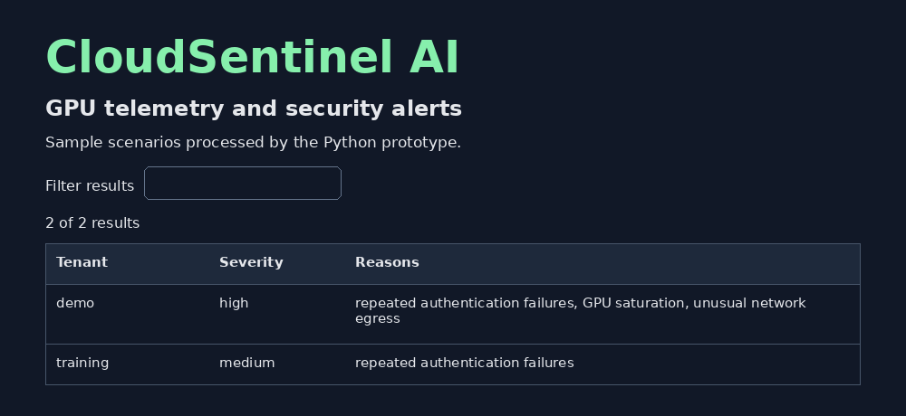

# CloudSentinel AI

Review suspicious activity across simulated cloud GPU tenants. The Python detector combines authentication and saturation thresholds with a statistical baseline for network egress.

[Open the live demo](https://lolstershwjav.github.io/cloudsentinel-ai/)

[](https://lolstershwjav.github.io/cloudsentinel-ai/)

## Try the demo

Enter `high` in **Filter results**. The `demo` tenant is flagged for repeated authentication failures, GPU saturation, and unusual egress. The `training` tenant shows how a single signal receives medium severity.

## How it works

The egress detector compares each reading to the batch mean plus two population standard deviations. An analyst can review the triggering signals before deciding whether to act.

The public demo filters precomputed results from synthetic examples. The Python prototype runs locally and requires no cloud credentials. Operational decisions require human review.

## Run locally

```bash
python3 demo_report.py
python3 -m http.server --directory docs
```

Open `http://localhost:8000` to preview the demo. To run the tests in a virtual environment, install `requirements.txt` and run `python -m pytest -q`.

## Deployment

GitHub Pages serves `docs/` from `main`. The preview image reproduces the demo’s published sample table.

## Roadmap

1. Add an optional LLM explanation adapter with schema validation and prompt-injection resistance.
2. Connect read-only cloud telemetry or ticket APIs with scoped credentials.
3. Build a FastAPI endpoint and TypeScript dashboard to collect user feedback and adoption metrics.
4. Add CI, structured logs, deployment documentation and measured before/after results.
